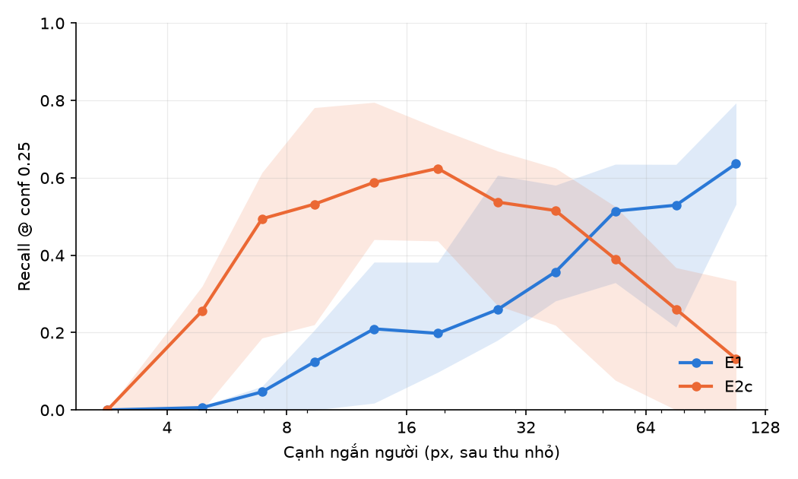

# Chương 5. Kết quả và thảo luận

> **Ghi chú bản nháp (xoá khi đưa vào quyển).** Nháp 7/11/2026 theo `docs/DAN_Y_LUAN_VAN.md` mục chương 5. Mọi số liệu chép từ `docs/results/` (mỗi bảng ghi file nguồn), các file đó chép từ CSV trong `runs/`. Chỗ đánh dấu **[CHỜ KHOÁ]** điền sau khi khoá và chấm tập ảnh lũ (11–13/11); **[CHỜ RQ2]** điền sau khi chạy đo tốc độ trên Kaggle T4. Kết quả "sơ bộ" và "mô phỏng" giữ nguyên nhãn đó. Thuật ngữ theo `docs/THUAT_NGU.md`. Số hình, số bảng đánh lại khi dàn trang.

Chương này trình bày kết quả theo ba câu hỏi nghiên cứu. Mỗi câu hỏi con có một tiểu mục: bảng số, điều bảng cho thấy, và giới hạn của nó. Cách đo, tập dữ liệu và mã thí nghiệm đã mô tả ở chương 4; ở đây chỉ nhắc lại khi cần để đọc đúng một bảng.

Ba quy ước đọc bảng xuyên suốt chương:

- **AP50** là độ chính xác trung bình ở IoU 0,5, tính từ dự đoán ở ngưỡng độ tin cậy (conf) 0,001. **Recall vận hành** là tỉ lệ người được phát hiện ở conf 0,25, ngưỡng mà một hệ thống thật sẽ dùng.
- **KTC 95%** là khoảng tin cậy 95% bằng bootstrap 1.000 lần, lấy mẫu theo ảnh, hoặc theo video khi các ảnh cùng video (SeaDronesSee).
- Khi so hai mô hình, "**có ý nghĩa**" nghĩa là khoảng tin cậy 95% của **hiệu số** (bootstrap cặp, cùng bộ ảnh cho cả hai mô hình) không chứa 0. Hai khoảng tin cậy riêng chồng nhau không có nghĩa là hai mô hình như nhau (mục 4.3).

## 5.1. Câu hỏi 1: phát hiện người nhỏ

### 5.1.1. Người nhỏ tới đâu thì bị bỏ sót (RQ1a)

**Mô hình chưa huấn luyện thêm.** Bảng 5.1 là mốc xuất phát: YOLO26s huấn luyện sẵn trên COCO, chạy toàn ảnh ở hai cỡ đầu vào, trên VisDrone val.

**Bảng 5.1.** Mô hình gốc trên VisDrone val, IoU 0,5 (`visdrone_baseline.md`).

| Cách chạy | Nhóm cỡ | AP50 | Recall vận hành | Recall tối đa |
|---|---|---|---|---|
| Toàn ảnh, đầu vào 640 (E0) | tất cả | 0,276 | 0,151 | 0,466 |
| | < 8 px | 0,050 | 0,007 | 0,105 |
| | 8–16 px | 0,254 | 0,104 | 0,460 |
| Toàn ảnh, đầu vào 1280 (E1) | tất cả | 0,497 | 0,321 | 0,720 |
| | < 8 px | 0,167 | 0,053 | 0,402 |
| | 8–16 px | 0,507 | 0,303 | 0,754 |
| | 16–32 px | 0,716 | 0,538 | 0,914 |
| | > 32 px | 0,836 | 0,735 | 0,968 |

Hai điều rút ra. Thứ nhất, **cỡ đầu vào quyết định trước tiên**: thu ảnh về 640 làm hơn một nửa số người không được phát hiện ở bất kỳ ngưỡng nào (recall tối đa 0,466), đúng như bảng số pixel theo độ cao ở chương 1 dự báo. Thứ hai, **mô hình gốc "thấy" người nhỏ nhưng không tự tin**: ở đầu vào 1280, recall tối đa của nhóm dưới 8 px là 0,402 nhưng recall vận hành chỉ 0,053. Phần lớn người nhỏ có box nhưng với độ tin cậy dưới ngưỡng. Đây là động lực trực tiếp cho việc tinh chỉnh mô hình (mục 5.1.2).

Hạ IoU từ 0,5 xuống 0,3 làm AP của nhóm dưới 8 px tăng từ 0,167 lên 0,342 (E1): ở người vài pixel, phần lớn "bỏ sót" theo IoU 0,5 thực ra là box lệch vài pixel. Với bài toán cứu hộ, một box lệch vài pixel quanh đúng người vẫn có ích, nên mọi bảng của nhóm dưới 8 px được báo thêm ở IoU 0,3 (chương 4).

**Recall theo số pixel trên người.** Để biết ngưỡng bỏ sót chính xác hơn bốn nhóm cỡ, ảnh 4K của SeaDronesSee được thu nhỏ 1, 2, 3, 4 và 6 lần, rồi chạy cắt ô sao cho một pixel ảnh đúng bằng một pixel vào mạng ở mọi mức. Như vậy số pixel trên người là biến duy nhất thay đổi (Bảng 5.2, Hình 5.1).

**Bảng 5.2.** Recall vận hành theo cạnh ngắn của người, SeaDronesSee thu nhỏ, bootstrap theo video (`e6_sds_pilot.md`). **Sơ bộ.**

| Cạnh ngắn (px) | Số người | Mô hình gốc (E1) | Mô hình chính (E2c) |
|---|---|---|---|
| 0–4 | 24 | 0,000 | 0,000 |
| 4–6 | 160 | 0,006 | 0,256 |
| 6–8 | 257 | 0,047 | 0,494 |
| 8–11 | 500 | 0,124 | 0,532 |
| 11–16 | 758 | 0,210 | 0,588 |
| 16–23 | 868 | 0,198 | 0,624 |
| 23–32 | 655 | 0,260 | 0,537 |
| 32–45 | 706 | 0,357 | 0,516 |
| 45–64 | 492 | 0,514 | 0,390 |
| 64–91 | 357 | 0,529 | 0,261 |
| ≥ 91 | 498 | 0,637 | 0,133 |

**Hình 5.1.** Recall vận hành theo cạnh ngắn của người trên SeaDronesSee thu nhỏ.

Dưới khoảng 6 px cả hai mô hình gần như không thấy người; muốn mô hình chính còn recall khoảng 0,5 thì người cần ít nhất khoảng 6–8 px. Đây là giới hạn dưới cho độ cao bay: với camera 4K và góc nhìn 82°, nó tương ứng với một độ cao tối đa cụ thể (bảng ở chương 1). Bảng 5.2 còn cho thấy một điều không dự kiến: **mô hình chính tụt mạnh với người to** (từ 45 px trở lên kém mô hình gốc). Mục 5.1.4 xử lý điểm yếu này.

Giới hạn: 1.055 người lặp lại ở năm mức thu nhỏ nên các nhóm cỡ không độc lập; 11 video nên khoảng tin cậy rất rộng (bảng đầy đủ kèm khoảng tin cậy ở `e6_sds_pilot.md`); thu nhỏ ảnh không tái tạo nhiễu cảm biến và nhoè của camera thật.

**Trên tập ảnh lũ.** [CHỜ KHOÁ] Bảng AP50 và recall vận hành theo bốn nhóm cỡ của các mô hình trên 188 khung lũ, bootstrap theo nguồn (9 cụm), IoU 0,5 và 0,3 cho nhóm dưới 8 px. Nguồn dự kiến: `docs/results/flood.md`, sinh từ `scripts/eval_flood.sh`.

### 5.1.2. Dữ liệu huấn luyện nào giúp (RQ1b)

Ba lần tinh chỉnh dùng cùng kiến trúc YOLO26s, cùng đầu vào 1280, chỉ khác dữ liệu:

- **chỉ ảnh drone đô thị** (E2): VisDrone;
- **thêm người dưới nước** (E2c): VisDrone cộng AFO;
- **thêm ảnh thảm hoạ có người cỡ to** (E2e): VisDrone, AFO cộng C2A.

**Ảnh drone đô thị giúp người nhỏ rất mạnh** (Bảng 5.3). Trên VisDrone val, AP50 nhóm dưới 8 px tăng từ 0,167 lên 0,554, và mức tăng giữ nguyên trên test-dev, tập không dùng để chọn trọng số. Mức tăng giảm dần theo cỡ người: mô hình gốc đã tốt với người to.

**Bảng 5.3.** Mô hình gốc (E1) và tinh chỉnh trên VisDrone (E2), IoU 0,5, bootstrap cặp (`visdrone_E2.md`).

| Tập | Nhóm cỡ | Mô hình gốc | Tinh chỉnh VisDrone | Hiệu (KTC 95%) |
|---|---|---|---|---|
| VisDrone val | tất cả | 0,497 | 0,758 | +0,261 (0,248 đến 0,275) |
| | < 8 px | 0,167 | 0,554 | +0,388 (0,361 đến 0,411) |
| | 8–16 px | 0,507 | 0,791 | +0,284 (0,266 đến 0,303) |
| | > 32 px | 0,836 | 0,884 | +0,048 (0,024 đến 0,077) |
| VisDrone test-dev | tất cả | 0,269 | 0,513 | +0,244 (0,231 đến 0,262) |
| | < 8 px | 0,086 | 0,247 | +0,161 (0,145 đến 0,181) |

Mức tăng recall vận hành còn lớn hơn mức tăng AP: trên val, nhóm dưới 8 px tăng từ 0,053 lên 0,480. Khoảng cách giữa recall vận hành và recall tối đa thu hẹp (tất cả cỡ: từ 0,322 so với 0,720 ở mô hình gốc xuống 0,687 so với 0,916), tức tinh chỉnh chủ yếu làm mô hình **tự tin hơn** với người nhỏ mà nó vốn đã thấy. Cái giá là precision vận hành giảm (test-dev, nhóm dưới 8 px: 0,762 xuống 0,573): mô hình bắn ra nhiều box hơn ở vật rất nhỏ. Báo nhầm kiểu này là việc của khâu xác nhận nhiều khung (mục 5.3.2), không phải của detector.

**Nhưng chỉ ảnh đô thị thì mất người dưới nước** (Bảng 5.4). Trên AFO test và SeaDronesSee, mô hình tinh chỉnh trên VisDrone **kém hơn cả mô hình gốc**, có ý nghĩa thống kê trên AFO. Người trong hai tập này phần lớn trên 32 px, nên nguyên nhân không phải kích thước mà là hình dạng: VisDrone chỉ có người đi bộ trên phố nhìn xiên; người bơi nằm ngang, chìm một phần, trên nền nước.

**Bảng 5.4.** AP50 trên dữ liệu có nước, IoU 0,5 (`afo_E1_E2.md`, `E2c.md`, `sds_det.md`).

| Tập | Mô hình gốc | Tinh chỉnh VisDrone | Thêm người dưới nước |
|---|---|---|---|
| AFO test (514 ảnh) | 0,147 | 0,103 | 0,568 |
| AFO test bỏ ảnh chung địa điểm với train (363 ảnh) | 0,188 | 0,105 | 0,734 |
| SeaDronesSee (317 ảnh, 11 video) | 0,535 | 0,186 | 0,468 |

Thêm AFO vào dữ liệu huấn luyện (E2c) lấy lại người dưới nước: trên AFO test hiệu so với mô hình gốc là +0,421 (+0,391 đến +0,454), có ý nghĩa. Trên SeaDronesSee, tập người dưới nước **độc lập** với dữ liệu huấn luyện, E2c hơn hẳn mô hình chỉ học VisDrone (+0,281, +0,053 đến +0,506, có ý nghĩa) nhưng **chưa hơn mô hình gốc** (−0,067, −0,426 đến +0,171, không có ý nghĩa). Vậy mức tăng lớn trên AFO test một phần do test và train cùng nguồn. Cái giá trên ảnh đô thị nhỏ: so với E2, VisDrone val giảm 0,011 (−0,015 đến −0,008) và test-dev giảm 0,006 (−0,010 đến −0,002), có ý nghĩa nhưng nhỏ hơn nhiều so với phần lấy lại được trên nước. **E2c được chọn làm mô hình chính** cho mọi phần sau.

**Thêm ảnh thảm hoạ có người cỡ to là kết quả âm** (Bảng 5.5). C2A được thêm vào để chữa điểm yếu với người to của E2c (Bảng 5.2). Dự đoán là người to tốt lên mà người nhỏ không đổi. Kết quả ngược lại: người nhỏ kém đi rõ trên cả hai tập VisDrone, còn trên SeaDronesSee, nơi người phần lớn to, mức tăng không có ý nghĩa thống kê.

**Bảng 5.5.** Mô hình chính (E2c) và thêm C2A (E2e), AP50 ở IoU 0,5, bootstrap cặp (`E2e.md`).

| Tập | Nhóm cỡ | Mô hình chính | Thêm C2A | Hiệu (KTC 95%) | Có ý nghĩa |
|---|---|---|---|---|---|
| VisDrone val | tất cả | 0,747 | 0,718 | −0,029 (−0,035 đến −0,023) | có |
| | < 8 px | 0,546 | 0,492 | −0,053 (−0,067 đến −0,040) | có |
| VisDrone test-dev | tất cả | 0,507 | 0,466 | −0,041 (−0,047 đến −0,035) | có |
| | < 8 px | 0,241 | 0,202 | −0,040 (−0,048 đến −0,030) | có |
| AFO test | tất cả | 0,568 | 0,624 | +0,057 (+0,037 đến +0,078) | có |
| SeaDronesSee | tất cả | 0,468 | 0,509 | +0,041 (−0,167 đến +0,167) | không |
| | > 32 px | 0,470 | 0,525 | +0,055 (−0,161 đến +0,173) | không |

Ở IoU 0,3 kết luận giữ nguyên. Một giải thích hợp lý, chưa kiểm chứng riêng: C2A chiếm 6.129 trên 15.387 ảnh huấn luyện và toàn người cỡ to, nên tỉ lệ người nhỏ trong dữ liệu giảm và mô hình dồn sức vào người to. Điều này đi ngược đúng cái đề tài cần, vì người trong ảnh lũ từ UAV phần lớn nhỏ. Kết quả âm này được giữ trong luận văn vì nó trả lời trực tiếp câu hỏi "thêm dữ liệu thảm hoạ có giúp không": với cách trộn dữ liệu đơn giản thì không. Cách trộn khác (lấy mẫu một phần C2A, cân bằng theo cỡ người) là hướng phát triển (chương 6).

**Trả lời RQ1b.** Ảnh drone đô thị dạy mô hình người nhỏ; ảnh người dưới nước giữ được người bơi mà không mất nhiều ở người nhỏ; ảnh thảm hoạ ghép người to, trộn thẳng vào, làm mất người nhỏ. [CHỜ KHOÁ] Đối chiếu ba mô hình trên tập ảnh lũ.

Giới hạn chung: mỗi cấu hình một seed (mục 4.5); số epoch khác nhau giữa các lần tinh chỉnh do giới hạn 12 giờ của Kaggle (60 epoch cho E2, 55 cho E2c và E2e).

### 5.1.3. Cắt ô và nhánh phát hiện P2 (RQ1c)

**Cắt ô.** Trên VisDrone, cắt ô 640 với lượt toàn ảnh (SAHI, E4) **không hơn** chạy toàn ảnh ở 1280: AP50 0,460 so với 0,497, nhóm dưới 8 px 0,149 so với 0,167 (`visdrone_baseline.md`), mà chậm hơn khoảng bốn lần trên cùng máy. Lý do nằm ở dữ liệu: ba phần tư ảnh val chỉ rộng 1360 px, nên chạy toàn ảnh ở 1280 đã gần như giữ nguyên độ phân giải gốc; cắt ô không thêm chi tiết mà lại sinh box bị cắt ở mép ô. Kết luận này **không** chuyển sang video 4K: ở ảnh 3840 px, chạy toàn ảnh ở 1280 phải thu nhỏ ba lần, còn cắt ô giữ nguyên độ phân giải.

Pipeline trên thiết bị biên dùng một bộ cắt ô riêng thay cho SAHI vì nó chạy mọi ô trong một lô và xuất được sang TensorRT (chương 3). Bootstrap cặp so với SAHI (Bảng 5.6) cho thấy chênh lệch nhỏ nhưng có ý nghĩa, và theo hướng chấp nhận được cho đề tài: kém hơn ở người to, nhỉnh hơn ở người dưới 8 px.

**Bảng 5.6.** Bộ cắt ô riêng so với SAHI, mô hình gốc, VisDrone val, bootstrap cặp (`visdrone_tiled_vs_sahi.md`).

| IoU | Nhóm cỡ | SAHI | Cắt ô riêng | Hiệu (KTC 95%) |
|---|---|---|---|---|
| 0,5 | tất cả | 0,460 | 0,452 | −0,008 (−0,011 đến −0,003) |
| 0,5 | < 8 px | 0,149 | 0,153 | +0,004 (+0,001 đến +0,009) |
| 0,5 | > 32 px | 0,749 | 0,706 | −0,043 (−0,071 đến −0,016) |
| 0,3 | tất cả | 0,569 | 0,585 | +0,016 (+0,012 đến +0,021) |
| 0,3 | < 8 px | 0,299 | 0,324 | +0,024 (+0,017 đến +0,031) |

Bảng này cũng minh hoạ vì sao cần bootstrap cặp: hai khoảng tin cậy riêng của AP50 (0,437–0,469 và 0,443–0,477) chồng nhau, nhìn riêng sẽ kết luận sai là "như nhau". Ở IoU 0,3 bộ cắt ô riêng **cao hơn**: box của nó tìm đúng chỗ nhưng kém khít hơn, vì gộp box giữa các ô bằng cách giữ box điểm cao nhất thay vì hợp nhất toạ độ. Hợp nhất toạ độ đã được thử và bỏ, vì box lớn điểm thấp phủ cả nhóm người kéo box từng người thành box cả nhóm.

**Nhánh P2.** Thêm tầng phát hiện ở bước 4 pixel (E3), cùng dữ liệu và cùng số epoch với mô hình chính, cho mức tăng có ý nghĩa nhưng rất nhỏ ở người dưới 8 px, và đổi lại kém hơn ở người to (Bảng 5.7).

**Bảng 5.7.** Thêm nhánh P2 (E3) so với mô hình chính (E2c), AP50 ở IoU 0,5, bootstrap cặp (`E3.md`).

| Tập | Nhóm cỡ | Mô hình chính | Thêm P2 | Hiệu (KTC 95%) | Có ý nghĩa |
|---|---|---|---|---|---|
| VisDrone val | tất cả | 0,747 | 0,747 | −0,000 (−0,005 đến +0,005) | không |
| | < 8 px | 0,546 | 0,558 | +0,012 (+0,000 đến +0,025) | có |
| | > 32 px | 0,888 | 0,858 | −0,029 (−0,045 đến −0,011) | có |
| VisDrone test-dev | < 8 px | 0,241 | 0,254 | +0,013 (+0,004 đến +0,021) | có |
| | > 32 px | 0,887 | 0,873 | −0,014 (−0,026 đến −0,003) | có |
| SeaDronesSee | tất cả | 0,468 | 0,408 | −0,060 (−0,104 đến +0,013) | không |

Ở IoU 0,3 mức tăng ở người dưới 8 px biến mất (val −0,008, −0,018 đến +0,003): P2 làm box người nhỏ **khít hơn** chứ không **tìm thấy nhiều người hơn**. Recall vận hành trên VisDrone còn thấp hơn (val −0,027, test-dev −0,025). Với chi phí tính toán 115,0 so với 93,9 GFLOPs và batch huấn luyện phải giảm một nửa vì tràn bộ nhớ, P2 không đáng so với mô hình chính.

**Trả lời RQ1c.** Trên ảnh độ phân giải vừa, cả cắt ô lẫn P2 đều không cải thiện đáng kể người nhỏ; mức tăng P2 mang lại (+0,012 AP50 ở nhóm dưới 8 px so với mô hình chính) rất nhỏ so với mức tăng do dữ liệu (+0,388 khi tinh chỉnh trên VisDrone so với mô hình gốc, Bảng 5.3). Cắt ô có ý nghĩa ở ảnh 4K, và khi đó phải đi cùng thu nhỏ theo độ cao (mục 5.1.4).

### 5.1.4. Thu nhỏ khung theo độ cao bay (RQ1d)

Bảng 5.2 cho thấy mô hình chính mạnh nhất với người khoảng 10–30 px và yếu với người trên 45 px. Một giải thích hợp lý: dữ liệu huấn luyện được thu về đầu vào 1280 và co giãn thêm khi tăng cường dữ liệu, nên người khi vào mạng hầu hết nhỏ. Thống kê nhãn ủng hộ giải thích này: ở đầu vào 1280 không co giãn, người trên 32 px chỉ chiếm 0,0477 số người của VisDrone train và 0,1833 của AFO train (`e6_sds_pilot.md`). Hệ quả là cắt ô ảnh 4K bay thấp ở độ phân giải gốc đưa vào mô hình đúng loại người nó yếu.

Đề tài đề xuất **thu nhỏ khung theo độ cao bay** (chương 3): từ độ cao và tiêu cự, ước lượng một người 0,5 m sẽ chiếm bao nhiêu pixel, rồi thu nhỏ khung trước khi cắt ô để người về khoảng một cỡ mục tiêu; không bao giờ phóng to. Bảng 5.8 thử trên SeaDronesSee 4K, tập duy nhất có cả nhãn người lẫn độ cao bay thật.

**Bảng 5.8.** Thu nhỏ theo độ cao, mô hình chính, SeaDronesSee 4K, IoU 0,5, bootstrap theo video (`scale_by_altitude.md`). **Sơ bộ.**

| Cách chạy | AP50 | KTC 95% | Recall vận hành | Precision vận hành |
|---|---|---|---|---|
| Mô hình gốc, toàn ảnh 1280 | 0,535 | 0,362–0,616 | 0,481 | 0,660 |
| Mô hình chính, toàn ảnh 1280 | 0,468 | 0,151–0,554 | 0,465 | 0,640 |
| Mô hình chính, cắt ô ở độ phân giải gốc | 0,235 | 0,083–0,551 | 0,374 | 0,065 |
| Mô hình chính, cắt ô, thu nhỏ về 20 px dự kiến | 0,523 | 0,337–0,660 | 0,510 | 0,690 |
| Mô hình chính, cắt ô, thu nhỏ về 10 px dự kiến | 0,531 | 0,451–0,684 | 0,579 | 0,656 |

So cặp: thu nhỏ về 10 px so với cắt ô ở độ phân giải gốc +0,296 AP50 (+0,061 đến +0,412) và +0,205 recall (+0,118 đến +0,318), có ý nghĩa; so với chạy toàn ảnh, recall cao hơn có ý nghĩa (+0,114, +0,053 đến +0,392) còn AP50 cao hơn nhưng chưa có ý nghĩa; so với mô hình gốc, AP50 ngang nhau (−0,005, −0,115 đến +0,273).

Ba điều rút ra. **Cắt ô ở độ phân giải gốc là cách tệ nhất** cho mô hình tinh chỉnh trên ảnh bay thấp: precision 0,065, nền bị báo nhầm rất nhiều. **Thu nhỏ theo độ cao sửa được gần hết**, và đưa mô hình chính về ngang mô hình gốc trên nước biển, trong khi vẫn giữ lợi thế lớn ở người nhỏ (Bảng 5.3). Điều này trả lời tốt hơn băn khoăn ở mục 5.1.2 ("mô hình chính chưa hơn mô hình gốc với người dưới nước"): một phần khoảng cách đến từ việc đưa người sai cỡ vào mô hình, không phải từ mô hình. Cuối cùng, cách này **dùng một dữ liệu drone vốn có** (độ cao bay) để chọn thang xử lý, thay vì cố định; đây là phần thứ nhất của luận điểm xuyên suốt (mục 5.4).

Hai biến thể của cùng ý tưởng đã được thử và không giữ lại: thêm một lượt toàn ảnh sau khi thu nhỏ để bắt người to bị cắt đôi giữa các ô không làm tăng AP50 (−0,013, −0,071 đến +0,001) mà tốn thêm một lượt suy luận mỗi khung (`full_pass.md`); theo chiều ngược lại, phóng to khung khi người dự kiến dưới 8 px không cải thiện có ý nghĩa ở mức thu nhỏ nào, trong khi số ô tăng hơn gấp đôi ở mức thu nhỏ 6 lần (`upscale_small.md`). Người dưới khoảng 6–8 px vì vậy vẫn là giới hạn dưới của khâu phát hiện; cách chữa là bay thấp hơn (mục 5.3.1).

Giới hạn: một tập, 11 video, người phần lớn to; cỡ mục tiêu 10 và 20 px được chọn sau khi xem kết quả trên chính tập này, nên đây là khảo sát chứ chưa phải đánh giá độc lập; góc nhìn camera giả định chung 82°, và ước lượng số pixel thường thấp hơn cỡ người trong nhãn. Tập ảnh lũ không có độ cao bay (video YouTube) nên không đánh giá được cách này trên ảnh lũ (quyết định đã ghi ở chương 4); phần kiểm chứng thêm nằm ở mô phỏng (mục 5.3.1).

### 5.1.5. Nhiễu riêng của cảnh lũ (RQ1e)

[CHỜ KHOÁ] Recall vận hành của mô hình chính theo từng thẻ ảnh của tập lũ (loá nước, vật trôi, nhoè chuyển động, mưa hoặc sương, người trên mái, người dưới nước), kèm số khung và số người mỗi thẻ, khoảng tin cậy theo nguồn. Nhận xét: thẻ nào kém rõ so với toàn tập; vì mỗi thẻ ít khung, chỉ kết luận khi khoảng tin cậy cho phép.

### 5.1.6. Từ ảnh đô thị và biển sang cảnh lũ (RQ1f)

[CHỜ KHOÁ] Bảng một dòng cho mỗi mô hình (gốc, tinh chỉnh VisDrone, mô hình chính, thêm C2A, thêm P2): AP50 trên VisDrone test-dev, SeaDronesSee, tập lũ. Câu hỏi cần trả lời: thứ hạng các mô hình trên tập lũ có giống trên hai tập công khai không; nếu khác thì tập nào dự báo tốt hơn cho cảnh lũ.

Dự đoán trước khi chấm, ghi lại để đối chiếu: người trong 188 khung lũ có cả người nhỏ trên mái lẫn người cỡ vừa dưới nước, nên mô hình chính được kỳ vọng hơn mô hình gốc ở người nhỏ và không kém ở người dưới nước. Nếu kết quả trái dự đoán thì việc đầu tiên là kiểm tra cấu hình và nhãn, chưa kết luận ngay.

## 5.2. Câu hỏi 2: chạy kịp trên thiết bị biên

Câu hỏi 2 đo trên GPU Tesla T4 của Kaggle với TensorRT, vì đề tài không có Jetson (chương 4). Số đo trên T4 không phải số của Jetson; điều nó cho biết là **thứ hạng tương đối** giữa các cấu hình trên cùng phần cứng và **khâu nào tốn thời gian nhất**. Thời gian đo trên máy cá nhân trong các mục trước (Mac, RTX 5060) chỉ dùng để so sánh tương đối và không xuất hiện trong mục này.

### 5.2.1. Nén mô hình và cấu hình tốt nhất (RQ2a, RQ2b)

[CHỜ RQ2] Bảng cho mỗi cấu hình (PyTorch FP32, TensorRT FP16, TensorRT INT8; toàn ảnh 1280 và cắt ô; có và không thu nhỏ theo độ cao): thời gian từng khâu (giải mã, cắt ô, suy luận, gộp box) theo trung vị và p95, số khung mỗi giây, AP50 và recall vận hành theo nhóm cỡ. Câu hỏi cần trả lời:

- INT8 mất bao nhiêu AP50 ở nhóm dưới 8 px so với FP16, bootstrap cặp;
- những cấu hình nào nằm trên **biên Pareto** (không cấu hình nào khác vừa nhanh hơn vừa có recall cao hơn), vẽ thành hình recall theo số khung mỗi giây;
- cấu hình nào đạt tần số cần thiết (mục 5.3.1) với recall cao nhất.

Nguồn: `notebooks/kaggle_rq2.ipynb`, `eval/timing_summary.py`, `eval/rq2_tradeoff.py`; file kết quả dự kiến `docs/results/rq2_t4.md`.

### 5.2.2. Thiết bị yếu (RQ2c)

[CHỜ RQ2] Bảng **ước lượng** cho Jetson Orin Nano từ giả lập thời gian thiết bị (chương 3), hồ sơ hiệu chỉnh theo tỉ lệ đo được trên T4. Bảng này để riêng và ghi rõ là ước lượng, không đặt cạnh số đo. Câu hỏi cần trả lời: với tần số tối thiểu ở mục 5.3.1, thiết bị yếu có theo kịp không; thu nhỏ theo độ cao giảm số ô phải chạy, nên giảm thời gian mỗi khung bao nhiêu.

## 5.3. Câu hỏi 3: báo đúng về trạm mặt đất

Phần lớn kết quả của câu hỏi 3 là **mô phỏng**: một chuyến bay giả với telemetry, người đứng yên ở vị trí biết trước, và một detector giả có recall lấy từ đường đo được ở Bảng 5.2. Mô phỏng cho phép đổi từng yếu tố (độ cao, GPS, mạng) trong khi giữ nguyên các yếu tố khác, điều không làm được với vài đoạn video thật. Phần dữ liệu thật là ba đoạn SeaDronesSee có telemetry (mục 5.3.2). Mọi số mô phỏng là trung bình 3 seed (chương 4, Bảng 4.7).

Một giả định chung cần nhớ khi đọc mục này: trong mô phỏng, các khung **độc lập** với nhau, người khó thấy ở khung này không khó hơn ở khung sau. Thực tế lỗi tương quan theo thời gian (sóng, loá kéo dài nhiều giây), nên mô phỏng **lạc quan** với các cấu hình dựa vào nhiều lần nhìn.

### 5.3.1. Bao nhiêu khung mỗi giây là đủ (RQ3a)

**Độ cao và cỡ người.** Bay cao thì người nhỏ đi nên mỗi khung khó thấy hơn, nhưng người nằm trong khung lâu hơn nên được nhìn nhiều lần hơn. Bảng 5.9 cho thấy với mô hình chính, lực thứ hai thắng.

**Bảng 5.9.** Tỉ lệ bỏ sót theo độ cao, 2 khung mỗi giây, recall theo cỡ người (`rq3_altitude.md`). **Mô phỏng.**

| Độ cao | Mô hình gốc | Mô hình chính |
|---|---|---|
| 30 m | 0,767 | 0,567 |
| 50 m | 0,567 | 0,033 |
| 80 m | 0,533 | 0,000 |
| 120 m | 0,600 | 0,000 |
| 160 m | 0,967 | 0,000 |
| 200 m | 0,900 | 0,000 |

Mô hình gốc không dùng được khi bay cao (bỏ sót từ 0,900 trở lên ở 160 m). Mô hình chính không bỏ sót ai từ 80 m tới 200 m, nhưng **bay thấp lại tệ**: ở 30 m người chỉ nằm trong ít khung mà vẫn cần thấy 3 lần.

**Tần số theo độ cao.** Thay vì cố định 2 khung mỗi giây, tần số được tính để mỗi người được nhìn một số lần định trước (`min_views`): tần số bằng số lần nhìn nhân vận tốc chia chiều dài vùng chụp, kẹp trong một trần. Bảng 5.10 so cách này với tần số cố định.

**Bảng 5.10.** Tỉ lệ bỏ sót / số khung chạy detector trong 60 s (`rq3_adaptive.md`). **Mô phỏng.**

| Độ cao | Cố định 2 khung/giây | Cố định 8 khung/giây | 12 lần nhìn, trần 8 |
|---|---|---|---|
| 30 m | 0,567 / 120 | 0,000 / 480 | 0,033 / 279,7 |
| 50 m | 0,067 / 120 | 0,000 / 480 | 0,000 / 169,3 |
| 80 m | 0,000 / 120 | 0,000 / 480 | 0,000 / 106,7 |
| 120 m | 0,000 / 120 | 0,000 / 480 | 0,000 / 71,7 |

Tần số theo độ cao **chuyển khung từ chỗ thừa sang chỗ thiếu**: bay thấp thì chạy nhiều khung hơn và gần hết bỏ sót (30 m: 0,033 so với 0,567), bay cao thì chạy ít khung hơn mà không bỏ sót (120 m: 71,7 khung so với 120). Số lần nhìn phải chọn theo recall: 6 lần nhìn là quá ít với recall mỗi khung khoảng 0,5 của mô hình chính (bỏ sót 0,100–0,333 ở mọi độ cao, `rq3_adaptive.md`). Trần tần số là chỗ câu hỏi 2 nối vào: nếu thiết bị chỉ chạy được 2 khung mỗi giây thì ở 30 m mọi mức số lần nhìn đều bị cắt về 2 và lợi ích biến mất.

Khi độ cao **đổi giữa chuyến** (dò ở 120 m rồi hạ xuống 40 m), 12 lần nhìn với trần 8 bỏ sót 0,033 với 137 khung, gần bằng xử lý cố định 8 khung mỗi giây (0,000 với 480 khung); thêm thu nhỏ về 10 px thì không bỏ sót ai (`rq3_altprofile.md`). Trong mô phỏng, thu nhỏ theo độ cao chỉ cải thiện nhỏ, vì người ở 30–120 m nằm trong khoảng 8–45 px, nơi đường recall của mô hình chính gần phẳng (Bảng 5.2); lợi ích đo được trên SeaDronesSee (Bảng 5.8) đến từ người trên 45 px và từ báo nhầm khi cắt ô người to, hai thứ mô phỏng không có.

**Trả lời RQ3a.** Không có một tần số đủ cho mọi độ cao. Tần số cần thiết phụ thuộc độ cao, vận tốc và recall của detector; tính nó từ telemetry giúp vừa giảm bỏ sót khi bay thấp vừa giảm tính toán khi bay cao. [CHỜ RQ2] Đối chiếu tần số cần thiết với tốc độ đo được.

### 5.3.2. Gom theo toạ độ mặt đất hay theo dõi trên ảnh (RQ3b)

Khâu xác nhận chỉ gửi cảnh báo khi một người được thấy đủ N = 3 lần. Hai cách ghép các lần thấy: **gom theo toạ độ mặt đất** (geo: chiếu box xuống mặt đất bằng telemetry, gom các điểm trong bán kính 3 m và cửa sổ 5 s), và **theo dõi trên ảnh** (ByteTrack, ghép box giữa hai khung theo độ chồng lấn; có hoặc không bù chuyển động camera bằng telemetry). **Sơ bộ** trên ba đoạn video thật SeaDronesSee-MOT có GPS, độ cao, hướng thật và nhãn người theo từng khung (Bảng 5.11).

**Bảng 5.11.** Xác nhận trên video thật, mô hình chính, 2 khung mỗi giây (`sds_mot_confirm.md`). **Sơ bộ.**

| Đoạn video | Cách xác nhận | Người được cảnh báo / đủ điều kiện | Cảnh báo | Nhầm | Lặp | Thời gian tới cảnh báo (s, trung vị) |
|---|---|---|---|---|---|---|
| v21, 40 m, 34 người | geo | 12 / 19 | 37 | 13 | 12 | 2,00 |
| | ByteTrack | 2 / 19 | 2 | 0 | 0 | 25,25 |
| | ByteTrack bù chuyển động | 2 / 19 | 4 | 0 | 2 | 21,00 |
| v5, 122–140 m, 6 người | geo | 6 / 6 | 9 | 3 | 0 | 1,00 |
| | ByteTrack | 6 / 6 | 11 | 0 | 5 | 1,50 |
| v13, 91 m, 2 người | geo | 2 / 2 | 4 | 0 | 2 | 3,00 |
| | ByteTrack | 1 / 2 | 2 | 0 | 1 | 1,00 |

(ByteTrack ở ngưỡng tạo track 0,1; ngưỡng 0,25 cho cùng số người được cảnh báo.)

Trên đoạn đông người nhất (v21), gom theo toạ độ mặt đất xác nhận được 12 trên 19 người, ByteTrack chỉ 2. **Nguyên nhân là tần số khung, không phải cách dùng tracker**: ở 2 khung mỗi giây, IoU giữa box thật của cùng một người ở hai khung liên tiếp có trung vị 0,46 (v21), 0,53 (v5) và chỉ 0,05 (v13), trong khi ở 30 khung mỗi giây là 0,93, 0,94 và 0,84. Drone trôi, xoay nhẹ, người bơi di chuyển và box nhỏ làm độ chồng lấn thấp ngay cả khi drone gần như đứng yên; cộng với recall mỗi khung thấp, ByteTrack gần như mỗi khung tạo track mới (v21: 314 lần ghép, 299 ID khác nhau). Chạy lại ở 10 khung mỗi giây thì ByteTrack hoạt động trở lại (12 trên 26 người).

Cái giá của geo là **cảnh báo lặp và cảnh báo nhầm**: một người bị tách thành nhiều cụm khi GPS thật trôi, và vật cố định được phát hiện lặp lại thành cảnh báo. Mục 5.3.5 xử lý cảnh báo lặp.

**Vì sao bù chuyển động bằng telemetry không đủ.** Có thể nghĩ dời box khung trước bằng chuyển động tính từ telemetry sẽ cứu được ByteTrack. Mô phỏng ở Bảng 5.12 cho thấy cách này gãy khi GPS nhiễu, và chỉ ra cơ chế: sai số của phép dời bằng **độ chênh nhiễu GPS giữa hai khung**, nên GPS càng nhảy nhanh (thời gian tương quan τ nhỏ) thì càng bỏ sót.

**Bảng 5.12.** Tỉ lệ bỏ sót theo nhiễu GPS, ở 50 m (`rq3_cmc_cause.md`). **Mô phỏng.**

| τ GPS | σ GPS | ByteTrack bù chuyển động | geo |
|---|---|---|---|
| 5 s | 0,5 m | 0,900 | 0,033 |
| 5 s | 1 m | 1,000 | 0,033 |
| 30 s | 0,5 m | 0,200 | 0,000 |
| 30 s | 1 m | 0,767 | 0,000 |
| 300 s | 0,5 m | 0,033 | 0,000 |
| 300 s | 1 m | 0,033 | 0,000 |

Geo gần như không bị ảnh hưởng (bỏ sót tối đa 0,033 ở mọi ô của lưới), vì nó so khoảng cách mặt đất với bán kính 3 m, rộng hơn nhiều so với độ chênh GPS giữa hai khung. Bù chuyển động bằng telemetry chỉ dùng được với GPS ổn định ngắn hạn (RTK, hoặc GPS đã lọc qua bộ ước lượng trạng thái của bộ điều khiển bay).

**Camera nghiêng.** Phép chiếu xuống mặt đất ban đầu giả định camera nhìn thẳng xuống. Mọi đoạn SeaDronesSee có drone di chuyển đều quay với gimbal nghiêng, nên phép chiếu được mở rộng để tính góc nghiêng và kiểm tra bằng độ tản vị trí của người gần như đứng yên (`georef_pitch.md`, **sơ bộ**). Kết quả lẫn lộn: tốt hơn rõ khi drone di chuyển với camera nghiêng vừa phải (ví dụ đoạn v8, pitch −48,0°: độ tản 4,982 m giảm còn 1,301 m), nhưng kém hơn khi camera gần chân trời và khi drone gần như đứng yên; tính chung trung vị độ tản tăng (1,336 lên 1,603 m) và chỉ 0,515 số track tốt hơn. Phép chiếu theo góc nghiêng vì vậy để tuỳ chọn, chưa bật mặc định.

**Trả lời RQ3b.** Khi chỉ xử lý vài khung mỗi giây, gom theo toạ độ mặt đất bền hơn theo dõi trên ảnh, cả trên video thật lẫn trong mô phỏng có nhiễu GPS. Đây là phần thứ ba của luận điểm xuyên suốt: telemetry của drone thay thế cho tính liên tục giữa các khung mà tracker trên ảnh cần. Giới hạn: ba đoạn video, drone gần như đứng yên; trường hợp drone bay nhanh vẫn dựa vào mô phỏng.

### 5.3.3. Sai số vị trí cảnh báo (RQ3c)

Mỗi cảnh báo mang toạ độ người và một bán kính sai số 1σ do hệ thống tự tính từ mô hình lan truyền sai số (chương 3: GPS 3 m, độ cao 2 m, hướng 2°, nghiêng 1° theo mặc định). Bảng 5.13 hỏi hai điều: vị trí lệch bao nhiêu khi GPS thật tốt hoặc tệ, và bán kính ghi kèm có chứa người thật không.

**Bảng 5.13.** Sai số vị trí ở cảnh báo đầu tiên của mỗi người, chỉ nhiễu GPS (`rq3_geoerr.md`). **Mô phỏng.**

| Độ cao | σ GPS | Sai số trung vị (m) | Trong bán kính 1σ | Trong vùng 95% | Bỏ sót |
|---|---|---|---|---|---|
| 50 m | 0 m | 0,250 | 1,000 | 1,000 | 0,000 |
| 50 m | 1 m | 1,282 | 1,000 | 1,000 | 0,000 |
| 50 m | 3 m | 3,956 | 0,278 | 1,000 | 0,033 |
| 50 m | 5 m | 6,591 | 0,181 | 0,833 | 0,100 |
| 100 m | 3 m | 4,275 | 0,274 | 1,000 | 0,033 |
| 100 m | 5 m | 7,362 | 0,241 | 0,763 | 0,033 |

**GPS là nguồn sai số chính**: sai số trung vị đi theo σ của GPS và gần như không đổi theo độ cao. **Vòng 1σ quá hẹp để đi tìm người**: khi GPS thật đúng bằng giả định (σ 3 m), chỉ khoảng một phần tư số người nằm trong bán kính 1σ (0,278 và 0,274). Điều này khớp lý thuyết: sai số hai chiều có phân bố Rayleigh, vòng 1σ chỉ chứa khoảng 39% xác suất. Vùng 95% (bán kính 2,448σ) chứa mọi người ở mọi ô có σ GPS không quá 3 m; vì vậy bản đồ ở trạm mặt đất vẽ **vùng tìm 95%**, không phải vòng 1σ. Khi GPS thật tệ hơn giả định (σ 5 m), vùng 95% không còn đủ (0,763–0,833): bán kính chỉ đúng khi mô hình sai số đặt theo GPS thật của drone. Đề tài vì vậy cho phép lấy σ GPS từ độ chính xác bộ thu tự báo ở từng khung. Trong mô phỏng, khi bộ thu báo đúng, vùng 95% chứa mọi người ở mọi ô, kể cả khi GPS kém đi giữa chuyến (σ cố định chỉ chứa 0,833–0,933 trong trường hợp này), và hẹp lại khi GPS tốt (50 m, σ 1 m: bán kính 8,069 xuống 4,141 m); nếu bộ thu báo lạc quan bằng nửa sai số thật thì vùng hẹp quá, chỉ còn 0,652–0,963 (`rq3_gpsacc.md`, **mô phỏng**).

**Lệch hướng bay gây tách nhầm khi bay cao.** Với GPS σ 1 m, la bàn lệch cố định 5° làm một người bị tách thành nhiều cảnh báo: trung bình 5,333 lần tách nhầm mỗi kịch bản ở 100 m, so với 0,333 ở 50 m (`rq3_geoerr.md`). Lệch hướng xoay toạ độ quanh điểm ngay dưới drone; bay càng cao thì cùng một góc lệch đẩy điểm chiếu đi càng xa, vượt bán kính gom 3 m. Trạm mặt đất gộp lại được phần này thành một sự cố (mục 5.3.5). Đề tài thêm một bước tự hiệu chỉnh trên UAV: khi bay thẳng, hướng di chuyển tính từ GPS là phép đo độc lập của hướng mũi máy, nên trung vị hiệu yaw − hướng di chuyển ước lượng được lệch la bàn (chương 3). Trong mô phỏng, lệch ước lượng sai tối đa 0,228° khi bay thẳng với GPS σ 1 m, và tách nhầm ở 100 m, lệch 5° giảm từ 5,333 xuống 0,333 mỗi kịch bản; khi la bàn không lệch, cái giá là sai số vị trí tăng nhẹ (1,387 lên 1,538 m) (`rq3_yawcalib.md`, **mô phỏng**). Đây thêm một ví dụ cho luận điểm xuyên suốt: chính telemetry của drone dùng để sửa telemetry.

Giới hạn: người đứng yên, camera nhìn thẳng xuống, detector giả có box đúng tâm người; người có cảnh báo lệch quá 10 m bị tính là bỏ sót và loại khỏi tỉ lệ "trong vùng", nên ở σ 5 m các tỉ lệ đó lạc quan.

### 5.3.4. Mất sóng và độ trễ cảnh báo (RQ3d)

Cảnh báo được ghi xuống đĩa trước khi gửi, và gửi lại với thời gian chờ tăng gấp đôi sau mỗi lần hỏng, trần 30 s (chương 3). Đề tài thêm **thăm dò đường truyền**: khi mọi gói đang chờ và đã 2 s không gửi gì, thử gửi gói toạ độ cũ nhất; gửi được thì gửi ngay mọi gói đang chờ. Bảng 5.14 so có và không thăm dò.

**Bảng 5.14.** Độ trễ cảnh báo tới trạm (`rq3_network.md`). **Mô phỏng.**

| Mất gói | Mất sóng | Thăm dò | Độ trễ trung vị (s) | Độ trễ lớn nhất (s) | Mất cảnh báo |
|---|---|---|---|---|---|
| 0 | không | không | 0,000 | 0,000 | 0,000 |
| 0 | 15–45 s | không | 8,667 | 36,500 | 0,000 |
| 0 | 15–45 s | có | 5,917 | 27,500 | 0,000 |
| 0,5 | không | không | 0,250 | 41,167 | 0,000 |
| 0,5 | không | có | 1,167 | 8,333 | 0,000 |
| 0,5 | 20–35 s | không | 3,000 | 48,000 | 0,033 |
| 0,5 | 20–35 s | có | 3,417 | 17,333 | 0,000 |
| 0,5 | 15–45 s | không | 10,583 | 60,500 | 0,000 |
| 0,5 | 15–45 s | có | 9,000 | 29,167 | 0,000 |

**Khi có thăm dò thì không mất cảnh báo nào**, kể cả mất một nửa số gói cộng 30 s mất sóng; không thăm dò thì có một ô mất 0,033 (một cảnh báo trong ba kịch bản không tới trạm sau 60 s gửi bù). **Độ trễ trung vị nhỏ; độ trễ lớn nhất mới là vấn đề**: với thời gian chờ tăng gấp đôi, một gói hỏng ngay trước khi sóng có lại có thể đợi thêm gần 30 s. Thăm dò cắt phần chờ thừa đó (mất gói 0,5: độ trễ lớn nhất 41,167 s còn 8,333 s) mà gần như không tốn thêm dữ liệu (2,647 so với 2,629 KB mỗi cảnh báo khi mất sóng 20–35 s), vì mỗi lần thăm dò chỉ là một gói toạ độ. Phần trễ còn lại khi đã thăm dò chủ yếu là chính khoảng mất sóng: cảnh báo tạo trong lúc mất sóng không thể tới trạm trước khi sóng có lại.

**Mất theo cụm.** Bảng 5.14 giả định mỗi lần gửi mất độc lập. Sóng yếu thật thường kéo dài, nên mô phỏng thêm mất theo cụm (mô hình Gilbert–Elliott: đường truyền đổi qua lại giữa trạng thái tốt và xấu, trạng thái xấu mất mọi gói) và so với mất rải rác ở **cùng tỉ lệ mất trung bình** (Bảng 5.14b; chuyến 120 s, 5 seed, nên không so thẳng với Bảng 5.14).

**Bảng 5.14b.** Mất rải rác so với mất theo cụm, tỉ lệ mất trung bình 0,5, có thăm dò (`rq3_burst.md`). **Mô phỏng.**

| Cách mất | Độ trễ trung vị (s) | Độ trễ lớn nhất (s) | Mất cảnh báo |
|---|---|---|---|
| Rải rác 0,5 | 0,850 | 8,400 | 0,000 |
| Cụm xấu 10 s / tốt 10 s | 4,350 | 15,800 | 0,000 |
| Cụm xấu 30 s / tốt 30 s | 19,900 | 44,400 | 0,000 |

Cùng tỉ lệ mất, cụm càng dài cảnh báo càng trễ, vì mọi lần gửi trong cụm đều hỏng; phần trễ này là chính độ dài cụm, không cách gửi lại nào rút ngắn được. Thăm dò vẫn giữ không mất cảnh báo nào ở mọi ô; không thăm dò thì các ô cụm 30 s mất 0,080–0,180 số cảnh báo.

Giới hạn: không có số đo mạng thật để chọn độ dài cụm; số seed ít so với độ dao động của cụm dài, nên độ trễ lớn nhất dao động mạnh giữa các seed (độ lệch chuẩn ở `rq3_network.md`, `rq3_burst.md`).

### 5.3.5. Gộp cảnh báo thành sự cố (RQ3e)

Geo sinh cảnh báo lặp (Bảng 5.11). Hai cách giảm lặp được so sánh trên ba đoạn video thật:

- **Bỏ ở thiết bị biên**: cảnh báo mới nằm trong 3 m quanh một cảnh báo đã gửi trong 60 s thì không gửi. Cách này giảm lặp (v21: 12 xuống 7) nhưng **mất người**: v21 còn 10 thay vì 12 người được cảnh báo, vì người bơi gần nhau bị coi là một (`alert_memory.md`).
- **Gộp ở trạm mặt đất**: mọi cảnh báo vẫn được gửi, trạm gắn mỗi cảnh báo vào sự cố gần nhất còn mở. Không cảnh báo nào bị bỏ; người vận hành mở sự cố vẫn thấy từng cảnh báo và ảnh cắt.

**Bảng 5.15.** Gộp cảnh báo geo thành sự cố ở trạm, theo bán kính gộp (`alert_memory.md`).

| Đoạn video | Bán kính gộp | Cảnh báo | Sự cố | Sự cố lẫn hơn một người | Người bị tách |
|---|---|---|---|---|---|
| v21 (12 người được báo) | 3 m | 37 | 27 | 6 | 6 |
| | 5 m | 37 | 19 | 5 | 6 |
| | 10 m | 37 | 10 | 3 | 3 |
| v5 (6 người) | 3 m | 9 | 9 | 0 | 0 |
| | 5 m | 9 | 8 | 0 | 0 |
| | 10 m | 9 | 4 | 2 | 0 |
| v13 (2 người) | 3 m | 4 | 3 | 0 | 1 |
| | 5 m | 4 | 2 | 0 | 0 |
| | 10 m | 4 | 1 | 1 | 0 |

Bán kính 5 m được chọn làm mặc định: hai đoạn thưa người gộp đúng hoàn toàn (v13 hết lặp, v5 không lẫn người), đoạn đông người v21 giảm 37 cảnh báo xuống 19 sự cố. Ở v21 không bán kính nào vừa hết tách vừa hết lẫn, vì người bơi sát nhau hơn độ trôi của vị trí: đó là giới hạn của định vị, không chữa được bằng luật gộp. Vì gộp ở trạm không bỏ cảnh báo nào, cái giá là hiển thị gộp nhóm chứ không phải mất người. Với cứu hộ, bỏ sót một người đắt hơn nhiều một cảnh báo thừa, nên đề tài **giữ mọi cảnh báo ở biên và gộp ở trạm**.

Giới hạn: ba đoạn video, đối chiếu với nhãn trong không gian ảnh; luật gộp theo sai số ghi kèm cảnh báo chưa thử được vì lúc chạy bán kính sai số còn là hằng số.

## 5.4. Luận điểm xuyên suốt: dữ liệu bay giúp cả ba khâu

[Viết sau khi đủ 5.1–5.3. Khung dự kiến dưới đây.]

Ba kết quả ở ba câu hỏi có chung một cơ chế: **dùng telemetry sẵn có của drone (độ cao, GPS, hướng) thay cho một giả định cố định**.

- **Phát hiện (RQ1d):** độ cao cho biết người sẽ to bao nhiêu pixel, nên chọn được mức thu nhỏ đưa người về cỡ mô hình làm tốt. Trên SeaDronesSee 4K, cách này nâng AP50 của mô hình chính khi cắt ô từ 0,235 lên 0,531 (Bảng 5.8).
- **Tốc độ (RQ2c):** cùng mức thu nhỏ đó giảm số ô phải chạy; cùng độ cao và vận tốc cho biết cần bao nhiêu khung mỗi giây (Bảng 5.10). [CHỜ RQ2] Số ô và thời gian mỗi khung giảm bao nhiêu.
- **Xác nhận (RQ3b):** GPS và hướng cho phép ghép các lần thấy theo toạ độ mặt đất, không cần box chồng lấn giữa hai khung; nhờ đó xác nhận được người ở 2 khung mỗi giây, nơi tracker trên ảnh gãy (Bảng 5.11, 5.12).

Mặt trái của luận điểm cũng phải nêu: hệ thống phụ thuộc vào chất lượng telemetry. GPS tệ hơn giả định làm vùng tìm 95% không còn đủ (Bảng 5.13), la bàn lệch gây tách nhầm khi bay cao, và góc gimbal nhiễu làm phép chiếu theo góc nghiêng kém hơn ở một số đoạn (mục 5.3.2).

## 5.5. Phân tích lỗi

[CHỜ KHOÁ] Ảnh bỏ sót và báo nhầm tiêu biểu của mô hình chính trên tập lũ, theo nhóm cỡ và thẻ ảnh, lấy từ báo cáo phân tích lỗi của giao diện thử nghiệm. Dự kiến các nhóm: người dưới 8 px bị bỏ sót; người bị che một phần bởi mái hoặc cây; vật trôi, phao, mảnh mái bị báo nhầm thành người; loá mặt nước. Mỗi nhóm một hình gồm vài ảnh cắt kèm box nhãn và box dự đoán.

Hai loại báo nhầm đã thấy trên dữ liệu có nước, ghi lại để đối chiếu: trên AFO, ván, thuyền và vật nổi bị gọi là người (precision vận hành của mô hình gốc 0,300, `afo_E1_E2.md`); trên SeaDronesSee, vật cố định được phát hiện lặp lại thành cảnh báo nhầm (v21: 13 trên 37 cảnh báo, Bảng 5.11).

## 5.6. Minh hoạ hệ thống

Phần này không đo gì mới; nó cho thấy các thành phần chạy cùng nhau thành một hệ thống.

- **Chuyến bay mô phỏng quét vùng lũ** (chương 3): drone bay zíc zắc, ảnh được dựng từ một cảnh lũ tổng hợp có mái nhà, cây, vật trôi và người, pipeline trên thiết bị biên chạy đúng như với video thật, trạm mặt đất hiện vị trí drone, vùng đã quét, cảnh báo và vùng tìm 95% trên bản đồ. Vì biết trước vị trí người, bản đồ đối chiếu được từng sự cố với người thật: tìm đúng, người nằm trong vùng tìm, bỏ sót, báo nhầm.
- **Video thật SeaDronesSee** với telemetry thật: cùng giao diện, cảnh báo trên ảnh 4K thật.
- **Hai drone** cùng gửi về một trạm (`multi_uav_demo.md`, **minh hoạ**): 37 cảnh báo mỗi drone gộp thành 20 sự cố, 18 sự cố có cả hai drone cùng thấy; hai drone phát lại cùng một đoạn video, chỉ khác GPS, nên đây là kiểm tra luồng dữ liệu, không phải đo độ chính xác gộp.
- **Sân thử** trong giao diện thử nghiệm: đổi độ cao, vận tốc, GPS, mạng, thiết bị, chạy lại chuyến bay và so các lần chạy cạnh nhau.

[Hình 5.x: ảnh chụp màn hình điều phối khi đang quét; Hình 5.y: bản đồ sau chuyến bay với lớp đối chiếu. Chụp khi dàn trang, từ `scripts/demo_bao_ve.sh`.]

## Tóm tắt chương

[Viết sau khi điền đủ các chỗ chờ. Khung dự kiến:]

- **Câu hỏi 1.** Dữ liệu huấn luyện quyết định nhiều nhất cho người nhỏ; kiến trúc (P2) và cắt ô trên ảnh độ phân giải vừa giúp rất ít. Mô hình tinh chỉnh yếu với người to; thu nhỏ theo độ cao bù được trên SeaDronesSee. Thêm ảnh thảm hoạ người to theo cách đơn giản làm mất người nhỏ. [CHỜ KHOÁ] Kết quả trên tập lũ.
- **Câu hỏi 2.** [CHỜ RQ2]
- **Câu hỏi 3.** Trong mô phỏng và trên ba đoạn video thật: gom theo toạ độ mặt đất bền hơn theo dõi trên ảnh ở 2 khung mỗi giây; tần số theo độ cao giảm bỏ sót khi bay thấp và giảm tính toán khi bay cao; vùng tìm 95% chứa người thật khi GPS không tệ hơn giả định; thăm dò đường truyền giữ không mất cảnh báo và cắt độ trễ lớn nhất; gộp ở trạm giảm lặp mà không bỏ cảnh báo.
