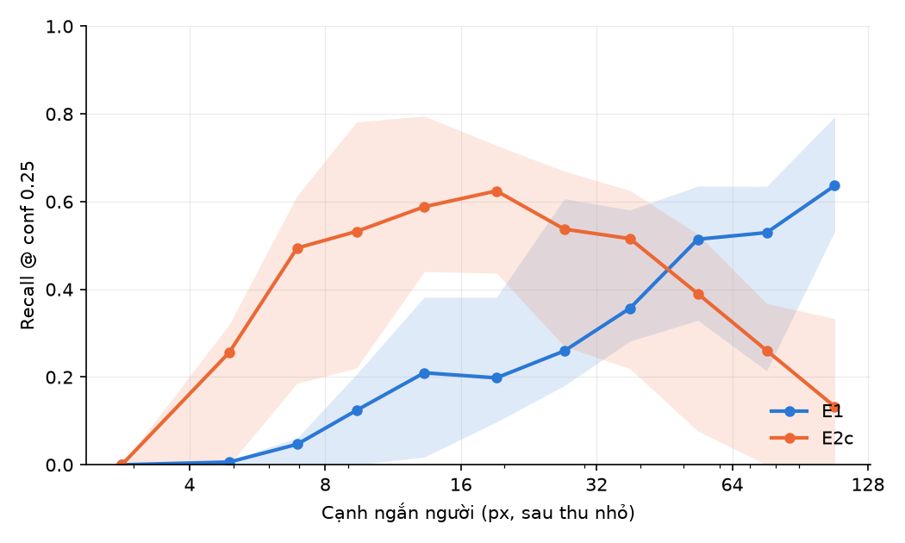

# E6 thử trên SeaDronesSee: recall theo số pixel trên người

**Bản thử, chưa phải E6 chính thức**: E6 đặt lại thành khảo sát recall theo số pixel (ROADMAP mục 5.3) còn chờ thầy duyệt (quyết định #1). Chạy trước trên SDS vì đây là tập 4K có nhãn duy nhất trong tay; người ở đây phần lớn to (cạnh ngắn trung vị 65 px, `sds_det.md`), nên thu nhỏ ra được đủ dải từ 4 tới hơn 90 px.

## Cách làm

- Dữ liệu: 317 ảnh 3840×2160, 1.055 người, 11 video (`data/processed/sds_det`, `sds_det.md`).
- Thu nhỏ cạnh ảnh 1, 2, 3, 4, 6 lần bằng `tools/rescale_dataset.py` (INTER_AREA, JPEG 95); nhãn chuẩn hoá giữ nguyên.
- Mỗi mức chạy bộ cắt ô riêng **ô 640, chồng 0,2, không có lượt toàn ảnh, imgsz 640**: mạng thấy ảnh đúng 1 pixel ảnh = 1 pixel vào mạng ở mọi mức, nên số pixel trên người là biến duy nhất thay đổi. Ở mức 6 (640×360) ô nhỏ hơn 640 chỉ được đệm, không bị phóng to.
- Mô hình: E1 (`yolo26s.pt`, gốc COCO) và E2c (`runs/train/E2c_s0`, + VisDrone + AFO, huấn luyện ở imgsz 1280). conf 0,001, max_det 1000.
- Chấm bằng `eval/recall_by_pixels.py`: gộp người của mọi mức, nhóm theo cạnh ngắn **sau thu nhỏ**; recall ở conf 0,25, IoU 0,5; khoảng tin cậy 95% bootstrap theo video (mọi mức của cùng video cùng vào hoặc cùng ra).
- Máy: RTX 5060 (WSL), chỉ có số độ chính xác, không đo tốc độ.

## Recall theo cạnh ngắn người

Số đọc từ `runs/e6_sds/eval/recall_by_pixels.csv`. Trong ngoặc là khoảng tin cậy 95%.

| Cạnh ngắn (px) | Số người | E1 | E2c |
|---|---|---|---|
| 0–4 | 24 | 0,000 (0,000–0,000) | 0,000 (0,000–0,000) |
| 4–6 | 160 | 0,006 (0,000–0,010) | 0,256 (0,000–0,320) |
| 6–8 | 257 | 0,047 (0,000–0,061) | 0,494 (0,186–0,613) |
| 8–11 | 500 | 0,124 (0,000–0,206) | 0,532 (0,220–0,781) |
| 11–16 | 758 | 0,210 (0,018–0,382) | 0,588 (0,440–0,795) |
| 16–23 | 868 | 0,198 (0,098–0,382) | 0,624 (0,437–0,728) |
| 23–32 | 655 | 0,260 (0,180–0,607) | 0,537 (0,270–0,670) |
| 32–45 | 706 | 0,357 (0,282–0,581) | 0,516 (0,219–0,625) |
| 45–64 | 492 | 0,514 (0,329–0,635) | 0,390 (0,077–0,526) |
| 64–91 | 357 | 0,529 (0,214–0,635) | 0,261 (0,000–0,368) |
| ≥ 91 | 498 | 0,637 (0,532–0,794) | 0,133 (0,000–0,333) |



## Mọi kích thước, theo mức thu nhỏ

Số đọc từ `runs/e6_sds/eval/recall_by_factor.csv`.

| Thu nhỏ | E1 recall | E1 AP50 | E2c recall | E2c AP50 |
|---|---|---|---|---|
| 1 | 0,451 (0,204–0,527) | 0,336 | 0,368 (0,204–0,600) | 0,234 |
| 2 | 0,410 (0,312–0,510) | 0,357 | 0,485 (0,226–0,654) | 0,468 |
| 3 | 0,355 (0,230–0,574) | 0,375 | 0,519 (0,210–0,667) | 0,448 |
| 4 | 0,186 (0,093–0,490) | 0,270 | 0,531 (0,189–0,624) | 0,416 |
| 6 | 0,101 (0,011–0,458) | 0,203 | 0,456 (0,128–0,535) | 0,319 |

Ở mức f, người có cạnh ngắn bằng 1/f so với ảnh gốc (trung vị gốc 65 px, `sds_det.md`).

## Nhận xét

1. **E2c giỏi người nhỏ, đúng mục tiêu fine-tune:** ở 6–23 px recall 0,494–0,624, so với 0,047–0,210 của E1.
2. **Nhưng E2c tụt mạnh với người to:** từ 45 px trở lên kém E1, ở ≥ 91 px còn 0,133 so với 0,637. Hai đường cắt nhau ở khoảng 32–64 px. Cách giải thích hợp lý nhất (chưa kiểm chứng riêng): dữ liệu huấn luyện của E2c là VisDrone và AFO đã thu về imgsz 1280, nên người khi vào mạng hầu hết nhỏ; mô hình quên dạng người to. Hệ quả: **không nên đưa người to vào E2c ở độ phân giải gốc**; với E2c, ảnh 4K nên thu về để người còn khoảng 10–30 px.
   Số liệu ủng hộ cách giải thích này (`tools/label_size_stats.py`, imgsz 1280, `runs/stats/{visdrone,afo}_train_1280/size_stats.csv`): khi không co giãn (s = 1), người trên 32 px chỉ chiếm 0,0477 số người trong VisDrone train và 0,1833 trong AFO train; ở s = 0,5 (cận dưới của `scale: 0.5`) còn 0,0027 và 0,0005.
3. Hệ quả cho cắt ô (E4): cắt ô ở độ phân giải gốc chỉ có lợi khi người ở độ phân giải gốc còn nhỏ (bay cao). Với người đã đủ to, cắt ô làm người "to lên" so với lúc huấn luyện và E2c kém đi. Kích thước ô và mức thu nhỏ nên chọn theo GSD để người rơi vào khoảng 10–30 px.
4. Với E6 nguyên bản: dưới khoảng 6 px cả hai mô hình gần như không thấy người; muốn E2c còn recall khoảng 0,5 thì người cần ít nhất khoảng 6–8 px.
5. Khuyến nghị "thêm dữ liệu người to khi fine-tune" (hoặc augmentation `scale` rộng hơn) là việc nên thử nếu tập lũ có nhiều người to; tập lũ sẽ trả lời.

## Giới hạn

- Chưa được duyệt làm E6; thu nhỏ không tái tạo nhiễu cảm biến, nhòe, nén của camera thật.
- Cùng 1.055 người lặp lại ở 5 mức: các nhóm kích thước không độc lập; khoảng tin cậy theo video (11 video) rất rộng.
- Cảnh biển, nước trong, người bơi; chưa phải nước lũ.
- Cắt ô không có lượt toàn ảnh: người rất to ở mức 1 có thể bị cắt giữa các ô; mức 1 của E1 ở đây (AP50 0,336) thấp hơn chạy toàn ảnh ở 1280 (0,535, `sds_det.md`), nên các số ở mức 1 thấp hơn cách chạy tốt nhất.

## Tái lập

```bash
.venv/bin/python tools/rescale_dataset.py --images data/processed/sds_det/images/val \
    --labels data/processed/sds_det/labels/val --dst data/processed/sds_rescale --factors 1 2 3 4 6
for f in 1 2 3 4 6; do
  for m in E1:yolo26s.pt E2c:runs/train/E2c_s0/weights/best.pt; do
    .venv/bin/python scripts/run_tiled.py --source data/processed/sds_rescale/x$f/images/val --model ${m#*:} \
        --tile 640 --overlap 0.2 --imgsz 640 --conf 0.001 --max-det 1000 --no-images --output runs/e6_sds/x$f/${m%%:*}
  done
done
.venv/bin/python eval/recall_by_pixels.py --data data/processed/sds_rescale --runs runs/e6_sds --models E1 E2c \
    --factors 1 2 3 4 6 --cluster-pattern '^(v\d+)_' --output runs/e6_sds/eval
```
