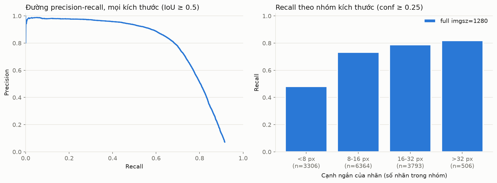
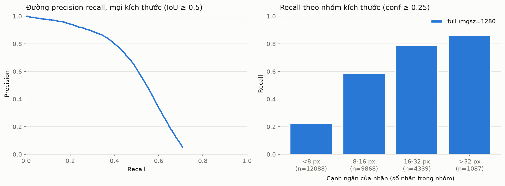

# VisDrone: E2 lượt 1 (fine-tune) so với E1

E2 lượt 1 là YOLO26s fine-tune trên VisDrone train, một lớp `person`. So với E1 (cùng mô hình gốc, chưa huấn luyện, cùng imgsz 1280) trên hai tập: **VisDrone val** và **VisDrone test-dev**. `best.pt` được chọn theo val, nên test-dev là tập kiểm tra độc lập (quyết định #11 ở ROADMAP).

## Huấn luyện

- Cấu hình `configs/experiments/E2_s0.yaml`, seed 0, imgsz 1280, batch 8, `scale` 0,5, **60 epoch** (file cấu hình ghi 100; notebook ghi đè để vừa giới hạn 12 giờ của Kaggle, giá trị thật trong `run_config.json`).
- Dữ liệu: VisDrone2019-DET train, 6.471 ảnh, 106.396 người; chưa có FinlandProper.
- Kaggle, một GPU Tesla T4; Python 3.13.15, torch 2.11.0+cu128, ultralytics 8.4.174; mã ở commit `6b7064e` (`dirty: false`).
- Chạy đủ 60 epoch trong 7,418 giờ. Batch giữ 8 suốt lần chạy; log có hai cảnh báo tràn bộ nhớ ở bộ gán nhãn (ảnh mosaic 905 và 1.624 người), ultralytics gán từng ảnh và giữ nguyên batch (TECHNICAL mục 13.5).
- `best.pt` là epoch 54: mAP50 do ultralytics tính trên val 0,733, epoch cuối 0,732. Chọn epoch gần như không làm số đẹp thêm.
- Nguồn: `runs/train/E2_s0/` (`run_config.json`, `results.csv`), log `runs/kaggle_E2/notebookcc8acc6d7f.log`.

## Môi trường đánh giá

Ngày 21–22/10/2026 trên WSL2, GPU NVIDIA GeForce RTX 5060 (CUDA); Python 3.12.3, torch 2.14.1, ultralytics 8.4.174. Trọng số: `yolo26s.pt` (SHA-256 bắt đầu bằng `646f8bc3fe0a`) cho E1, `runs/train/E2_s0/weights/best.pt` (`eb43853e80f6`) cho E2.

E1 ở đây được **chạy lại trên máy này** để so cặp với E2. Kết quả lệch so với E1 trong `visdrone_baseline.md` (đo trên Mac, MPS) nhiều nhất 0,003 ở mỗi ô; AP50 toàn bộ bằng nhau (0,497).

## Dữ liệu đánh giá

| Tập | Ảnh | Người | <8 px | 8–16 px | 16–32 px | >32 px |
|---|---|---|---|---|---|---|
| VisDrone val | 548 | 13.969 | 3.306 | 6.364 | 3.793 | 506 |
| VisDrone test-dev | 1.610 | 27.382 | 12.088 | 9.868 | 4.339 | 1.087 |

Test-dev có tỉ lệ người dưới 8 px gần gấp đôi val (44% so với 24%), nên khó hơn và gần bài toán của đề tài hơn. Cả hai tập đã đối chiếu từng ảnh với nhãn gốc (`runs/data/visdrone_check*.json`, TECHNICAL mục 6.7).

## Cấu hình

| Mã | Trọng số | Suy luận |
|---|---|---|
| E1 | `yolo26s.pt` (COCO) | Toàn ảnh, imgsz 1280 |
| E2 | `best.pt` của E2_s0 | Toàn ảnh, imgsz 1280 |

Chung: conf 0,001, `max_det` 1000; AP nội suy 101 điểm; recall và precision vận hành ở conf 0,25; vùng bỏ qua của VisDrone không tính là sai; khoảng tin cậy 95% bootstrap 1.000 lần theo ảnh. Hiệu số E2 − E1 tính bằng bootstrap cặp (`eval/compare_runs.py`).

## Kết quả trên VisDrone val

### IoU 0,5

| Cấu hình | Nhóm | Số người | AP | KTC 95% của AP | Recall @0,25 | Precision @0,25 | Recall tối đa |
|---|---|---|---|---|---|---|---|
| E1 | tất cả | 13.969 | 0,497 | 0,480–0,515 | 0,322 | 0,833 | 0,720 |
|  | <8 px | 3.306 | 0,167 | 0,149–0,188 | 0,053 | 0,710 | 0,401 |
|  | 8–16 px | 6.364 | 0,507 | 0,487–0,528 | 0,304 | 0,830 | 0,753 |
|  | 16–32 px | 3.793 | 0,716 | 0,686–0,743 | 0,539 | 0,846 | 0,913 |
|  | >32 px | 506 | 0,836 | 0,792–0,874 | 0,733 | 0,851 | 0,966 |
| E2 | tất cả | 13.969 | 0,758 | 0,746–0,770 | 0,687 | 0,796 | 0,916 |
|  | <8 px | 3.306 | 0,554 | 0,530–0,580 | 0,480 | 0,709 | 0,802 |
|  | 8–16 px | 6.364 | 0,791 | 0,778–0,806 | 0,732 | 0,790 | 0,939 |
|  | 16–32 px | 3.793 | 0,859 | 0,838–0,877 | 0,787 | 0,854 | 0,973 |
|  | >32 px | 506 | 0,884 | 0,852–0,912 | 0,818 | 0,873 | 0,968 |

| Nhóm | Hiệu AP (E2 − E1) | KTC 95% | Hiệu recall @0,25 | KTC 95% |
|---|---|---|---|---|
| tất cả | +0,261 | 0,248–0,275 | +0,365 | 0,348–0,384 |
| <8 px | +0,388 | 0,361–0,411 | +0,428 | 0,402–0,453 |
| 8–16 px | +0,284 | 0,266–0,303 | +0,428 | 0,403–0,455 |
| 16–32 px | +0,143 | 0,126–0,159 | +0,247 | 0,220–0,274 |
| >32 px | +0,048 | 0,024–0,077 | +0,085 | 0,047–0,129 |

### IoU 0,3

| Cấu hình | Nhóm | Số người | AP | KTC 95% của AP | Recall @0,25 | Precision @0,25 | Recall tối đa |
|---|---|---|---|---|---|---|---|
| E1 | tất cả | 13.969 | 0,593 | 0,577–0,610 | 0,343 | 0,888 | 0,835 |
|  | <8 px | 3.306 | 0,339 | 0,313–0,368 | 0,076 | 0,912 | 0,620 |
|  | 8–16 px | 6.364 | 0,613 | 0,593–0,633 | 0,330 | 0,893 | 0,869 |
|  | 16–32 px | 3.793 | 0,778 | 0,752–0,804 | 0,569 | 0,883 | 0,957 |
|  | >32 px | 506 | 0,878 | 0,842–0,909 | 0,763 | 0,885 | 0,978 |
| E2 | tất cả | 13.969 | 0,822 | 0,813–0,832 | 0,721 | 0,836 | 0,974 |
|  | <8 px | 3.306 | 0,688 | 0,665–0,710 | 0,547 | 0,789 | 0,936 |
|  | 8–16 px | 6.364 | 0,848 | 0,838–0,860 | 0,767 | 0,825 | 0,985 |
|  | 16–32 px | 3.793 | 0,893 | 0,877–0,907 | 0,813 | 0,878 | 0,990 |
|  | >32 px | 506 | 0,926 | 0,901–0,947 | 0,856 | 0,921 | 0,984 |

| Nhóm | Hiệu AP (E2 − E1) | KTC 95% | Hiệu recall @0,25 | KTC 95% |
|---|---|---|---|---|
| tất cả | +0,229 | 0,214–0,243 | +0,378 | 0,359–0,399 |
| <8 px | +0,349 | 0,319–0,376 | +0,471 | 0,444–0,497 |
| 8–16 px | +0,235 | 0,216–0,255 | +0,437 | 0,410–0,467 |
| 16–32 px | +0,114 | 0,096–0,131 | +0,244 | 0,212–0,273 |
| >32 px | +0,048 | 0,027–0,073 | +0,093 | 0,055–0,135 |



## Kết quả trên VisDrone test-dev (không dùng để chọn `best.pt`)

### IoU 0,5

| Cấu hình | Nhóm | Số người | AP | KTC 95% của AP | Recall @0,25 | Precision @0,25 | Recall tối đa |
|---|---|---|---|---|---|---|---|
| E1 | tất cả | 27.382 | 0,269 | 0,244–0,294 | 0,159 | 0,778 | 0,482 |
|  | <8 px | 12.088 | 0,086 | 0,072–0,100 | 0,020 | 0,762 | 0,215 |
|  | 8–16 px | 9.868 | 0,309 | 0,285–0,332 | 0,168 | 0,748 | 0,603 |
|  | 16–32 px | 4.339 | 0,561 | 0,529–0,587 | 0,389 | 0,788 | 0,844 |
|  | >32 px | 1.087 | 0,785 | 0,731–0,831 | 0,716 | 0,833 | 0,926 |
| E2 | tất cả | 27.382 | 0,513 | 0,481–0,547 | 0,467 | 0,693 | 0,709 |
|  | <8 px | 12.088 | 0,247 | 0,224–0,273 | 0,223 | 0,573 | 0,477 |
|  | 8–16 px | 9.868 | 0,626 | 0,604–0,650 | 0,585 | 0,679 | 0,858 |
|  | 16–32 px | 4.339 | 0,830 | 0,811–0,847 | 0,788 | 0,813 | 0,954 |
|  | >32 px | 1.087 | 0,899 | 0,874–0,920 | 0,861 | 0,853 | 0,971 |

| Nhóm | Hiệu AP (E2 − E1) | KTC 95% | Hiệu recall @0,25 | KTC 95% |
|---|---|---|---|---|
| tất cả | +0,244 | 0,231–0,262 | +0,308 | 0,289–0,330 |
| <8 px | +0,161 | 0,145–0,181 | +0,202 | 0,185–0,223 |
| 8–16 px | +0,317 | 0,298–0,342 | +0,417 | 0,397–0,442 |
| 16–32 px | +0,269 | 0,247–0,293 | +0,399 | 0,368–0,432 |
| >32 px | +0,114 | 0,084–0,152 | +0,145 | 0,111–0,186 |

### IoU 0,3

| Cấu hình | Nhóm | Số người | AP | KTC 95% của AP | Recall @0,25 | Precision @0,25 | Recall tối đa |
|---|---|---|---|---|---|---|---|
| E1 | tất cả | 27.382 | 0,358 | 0,332–0,387 | 0,176 | 0,859 | 0,624 |
|  | <8 px | 12.088 | 0,197 | 0,176–0,221 | 0,031 | 0,903 | 0,388 |
|  | 8–16 px | 9.868 | 0,432 | 0,405–0,459 | 0,194 | 0,858 | 0,757 |
|  | 16–32 px | 4.339 | 0,646 | 0,618–0,671 | 0,420 | 0,852 | 0,921 |
|  | >32 px | 1.087 | 0,822 | 0,772–0,864 | 0,733 | 0,866 | 0,962 |
| E2 | tất cả | 27.382 | 0,651 | 0,627–0,674 | 0,532 | 0,788 | 0,870 |
|  | <8 px | 12.088 | 0,461 | 0,436–0,483 | 0,320 | 0,757 | 0,752 |
|  | 8–16 px | 9.868 | 0,742 | 0,724–0,759 | 0,642 | 0,768 | 0,957 |
|  | 16–32 px | 4.339 | 0,881 | 0,865–0,894 | 0,827 | 0,849 | 0,985 |
|  | >32 px | 1.087 | 0,919 | 0,899–0,938 | 0,877 | 0,877 | 0,980 |

| Nhóm | Hiệu AP (E2 − E1) | KTC 95% | Hiệu recall @0,25 | KTC 95% |
|---|---|---|---|---|
| tất cả | +0,293 | 0,278–0,308 | +0,357 | 0,340–0,376 |
| <8 px | +0,264 | 0,240–0,284 | +0,289 | 0,267–0,311 |
| 8–16 px | +0,310 | 0,288–0,334 | +0,448 | 0,425–0,474 |
| 16–32 px | +0,235 | 0,213–0,260 | +0,407 | 0,373–0,443 |
| >32 px | +0,098 | 0,069–0,135 | +0,143 | 0,110–0,185 |



## Nhận xét

1. **Fine-tune cải thiện mạnh, nhất là ở người nhỏ.** Trên val, AP50 toàn bộ tăng từ 0,497 lên 0,758; nhóm dưới 8 px từ 0,167 lên 0,554. Trên test-dev, toàn bộ từ 0,269 lên 0,513; nhóm dưới 8 px từ 0,086 lên 0,247. Mọi hiệu số đều có khoảng tin cậy 95% nằm hẳn trên 0. Mức tăng giảm dần theo kích thước (>32 px chỉ tăng 0,048 trên val), khớp với dự đoán ở TECHNICAL mục 3.5: mô hình gốc đã tốt với người lớn.
2. **Đúng cơ chế đã dự đoán: mô hình "thấy" nhưng không tự tin.** Ở E1, recall ở conf 0,25 thấp xa recall tối đa (val: 0,322 so với 0,720). E2 thu hẹp khoảng cách này (0,687 so với 0,916): phần lớn mức tăng recall vận hành đến từ việc mô hình tự tin hơn với người nhỏ, cộng với recall tối đa cũng tăng.
3. **Precision ở conf 0,25 giảm.** Val: 0,833 → 0,796; test-dev: 0,778 → 0,692, riêng nhóm dưới 8 px 0,762 → 0,573. Mô hình fine-tune bắn ra nhiều box hơn ở vật rất nhỏ, nên ở ngưỡng mặc định có nhiều báo nhầm hơn. Đây là đầu vào cho bước xác nhận nhiều khung (TECHNICAL mục 9.5) và cho việc chọn ngưỡng trên val, không phải lỗi.
4. **Kết quả không phải do chọn mô hình trên val.** Mức tăng giữ nguyên trên test-dev (tập không dùng khi chọn), và `best.pt` gần như bằng epoch cuối.
5. **Test-dev thấp hơn val ở cả hai mô hình** vì có nhiều người dưới 8 px hơn hẳn; cùng một nhóm kích thước thì hai tập cho số gần nhau hơn (ví dụ nhóm 16–32 px của E2: 0,859 trên val, 0,830 trên test-dev).

## Thời gian (RTX 5060 trên WSL2; chỉ để so sánh tương đối, không phải số cho Jetson)

| Cấu hình | ms/ảnh (trung vị), val |
|---|---|
| E1 | 18,2 |
| E2 | 15,4 |

Cùng kiến trúc và imgsz; chênh lệch nhỏ có thể do đầu ra một lớp thay vì 80 lớp. Không dùng con số này cho RQ2.

## Giới hạn

- VisDrone là cảnh đô thị, không có nước: kết quả cho thấy fine-tune giúp người nhỏ nhìn từ trên cao, chưa nói gì về cảnh lũ. Kết luận chính phải chờ tập test lũ.
- Một seed (seed 0); cấu hình cuối cần 3 seed (mục 15.2 của TECHNICAL).
- Huấn luyện 60 epoch thay vì 100 như file cấu hình; chưa biết 100 epoch có tốt hơn không.
- Lượt 1 chỉ có VisDrone; lượt 2 thêm dữ liệu người dưới nước và C2A.
- Báo cáo trên test-dev là đề xuất, đang chờ thầy duyệt (quyết định #11).

## Tái lập

```bash
# Huấn luyện: notebooks/kaggle_train.ipynb, COMMIT 6b7064e, CONFIG configs/experiments/E2_s0.yaml, MODE "train", EPOCHS 60
python tools/convert_visdrone.py --src data/raw/visdrone/VisDrone2019-DET-test-dev --split test-dev
D=data/processed/visdrone
python scripts/run_baseline.py --config configs/experiments/E1_visdrone.yaml
python scripts/run_baseline.py --config configs/experiments/E2_visdrone.yaml
python scripts/run_baseline.py --config configs/experiments/E1_visdrone-testdev.yaml
python scripts/run_baseline.py --config configs/experiments/E2_visdrone-testdev.yaml
for iou in 0.5 0.3; do
  for r in E1 E2; do
    python eval/eval_by_size.py --runs runs/visdrone/$r --images $D/images/val --labels $D/labels/val \
        --ignore $D/ignore/val --iou $iou --output runs/visdrone/eval_${r}_iou$iou
    python eval/eval_by_size.py --runs runs/visdrone-testdev/$r --images $D/images/test-dev --labels $D/labels/test-dev \
        --ignore $D/ignore/test-dev --iou $iou --output runs/visdrone-testdev/eval_${r}_iou$iou
  done
  python eval/compare_runs.py --a runs/visdrone/E1 --b runs/visdrone/E2 --images $D/images/val --labels $D/labels/val \
      --ignore $D/ignore/val --iou $iou --output runs/visdrone/compare_E1_E2_iou$iou
  python eval/compare_runs.py --a runs/visdrone-testdev/E1 --b runs/visdrone-testdev/E2 --images $D/images/test-dev \
      --labels $D/labels/test-dev --ignore $D/ignore/test-dev --iou $iou --output runs/visdrone-testdev/compare_E1_E2_iou$iou
done
```

`eval_by_size.py` không gộp được hai lần chạy cùng `method` và `imgsz` vào một bảng, nên E1 và E2 được đánh giá riêng.
