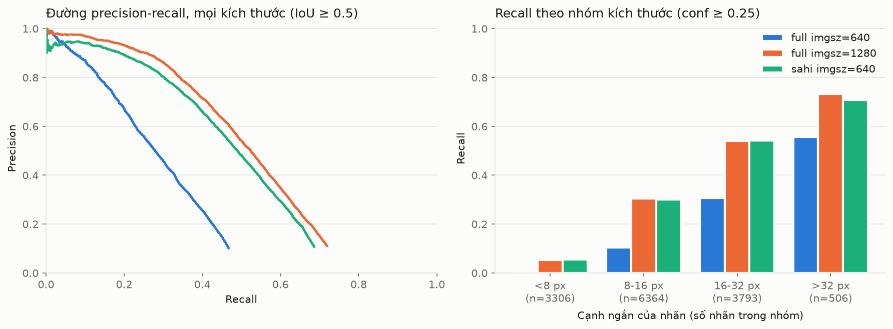

# VisDrone val: E0, E1, E4 (chưa huấn luyện)

Chạy lần đầu 10/10/2026 trên Mac M4 (MPS); thư mục kết quả đó không còn, nên **chạy lại 7/11/2026 trên RTX 5060 (WSL)** cùng cấu hình (`runs/visdrone/E0`, `E1`, `E4`; `E1` là lần chạy lại ở `visdrone_E2.md`). Số dưới đây là của lần chạy lại; so với bản Mac, AP50 nhóm tất cả lệch nhiều nhất 0,001 (E0 0,276 → 0,277), phần lớn các ô khác lệch dưới 0,005; lệch lớn nhất là precision vận hành của E0 ở nhóm dưới 8 px (0,727 → 0,706), nơi chỉ còn rất ít box ở conf ≥ 0,25. Khác biệt số học giữa MPS và CUDA; kết luận không đổi. Mô hình `yolo26s.pt` (COCO, SHA-256 bắt đầu bằng `646f8bc3fe0a`), ultralytics 8.4.174, torch 2.14.1, sahi 0.12.8.

## Dữ liệu

VisDrone2019-DET val: 548 ảnh, 13.969 người (gộp `pedestrian` và `people`), 1.410 vùng bỏ qua.

| Nhóm (cạnh ngắn) | <8 px | 8–16 px | 16–32 px | >32 px |
|---|---|---|---|---|
| Số người | 3.306 | 6.364 | 3.793 | 506 |

Độ phân giải ảnh: 408 ảnh 1360×765, 121 ảnh 960×540, 19 ảnh 1920×1080.

## Cấu hình

| Mã | Cấu hình |
|---|---|
| E0 | Toàn ảnh, imgsz 640 |
| E1 | Toàn ảnh, imgsz 1280 |
| E4 | SAHI: lát 640×640, chồng 0,2, gộp thêm lượt suy luận toàn ảnh ở 640 (mặc định của SAHI), hậu xử lý GREEDYNMM |

Chung: dự đoán ở conf 0,001, `max_det` 1000; AP nội suy 101 điểm; recall và precision vận hành ở conf 0,25; dự đoán rơi vào vùng bỏ qua của VisDrone không bị tính là sai.

## Kết quả, IoU 0,5

| Cấu hình | Nhóm | AP50 | Recall @0,25 | Precision @0,25 | Recall tối đa |
|---|---|---|---|---|---|
| E0 | tất cả | 0,277 | 0,151 | 0,772 | 0,467 |
|  | <8 px | 0,050 | 0,007 | 0,706 | 0,105 |
|  | 8–16 px | 0,255 | 0,105 | 0,790 | 0,462 |
|  | 16–32 px | 0,478 | 0,306 | 0,777 | 0,745 |
|  | >32 px | 0,668 | 0,557 | 0,729 | 0,868 |
| E1 | tất cả | 0,497 | 0,322 | 0,833 | 0,720 |
|  | <8 px | 0,167 | 0,053 | 0,710 | 0,401 |
|  | 8–16 px | 0,507 | 0,304 | 0,830 | 0,753 |
|  | 16–32 px | 0,716 | 0,539 | 0,846 | 0,913 |
|  | >32 px | 0,836 | 0,733 | 0,851 | 0,966 |
| E4 | tất cả | 0,460 | 0,321 | 0,777 | 0,686 |
|  | <8 px | 0,149 | 0,054 | 0,636 | 0,384 |
|  | 8–16 px | 0,470 | 0,301 | 0,792 | 0,716 |
|  | 16–32 px | 0,673 | 0,543 | 0,786 | 0,878 |
|  | >32 px | 0,749 | 0,708 | 0,741 | 0,927 |

## Nhóm dưới 8 px ở IoU 0,3

| Cấu hình | AP30 | Recall @0,25 | Recall tối đa |
|---|---|---|---|
| E0 | 0,172 | 0,017 | 0,259 |
| E1 | 0,339 | 0,076 | 0,620 |
| E4 | 0,300 | 0,076 | 0,613 |

Hạ IoU từ 0,5 xuống 0,3 làm AP của nhóm dưới 8 px tăng khoảng gấp đôi: phần lớn "bỏ sót" ở nhóm này thực ra là box lệch vài pixel.

## Thời gian (RTX 5060 trên WSL; chỉ để so sánh tương đối, `mean_ms_per_image` của `summary.csv`)

| Cấu hình | ms/ảnh |
|---|---|
| E0 | 12,9 |
| E1 | 19,3 |
| E4 | 141,1 |



## Nhận xét

1. **Tăng imgsz từ 640 lên 1280 gần như gấp đôi AP50** (0,277 → 0,497), mạnh nhất ở nhóm nhỏ: nhóm 8–16 px tăng từ 0,255 lên 0,507, nhóm dưới 8 px từ 0,050 lên 0,167.
2. **Recall vận hành rất thấp ở người nhỏ.** Ở conf 0,25, mô hình gốc chỉ bắt được 5% người dưới 8 px và 30% người 8–16 px, dù khi hạ ngưỡng thì recall tối đa lên tới 40% và 75%. Mô hình COCO có thấy người nhỏ nhưng với độ tin cậy thấp. Đây là động lực trực tiếp cho fine-tune (E2) và cho việc chọn ngưỡng theo hướng ưu tiên recall.
3. **SAHI (E4) không hơn imgsz 1280 trên VisDrone, lại chậm hơn nhiều** (141,1 so với 19,3 ms/ảnh trên cùng máy). Lý do: 75% ảnh val chỉ rộng 1360 px, nên suy luận ở 1280 đã gần như giữ nguyên độ phân giải gốc; cắt lát 640 không thêm chi tiết mà lại sinh box bị cắt ở mép lát, làm giảm precision. Kết luận này **không** chuyển được sang video 4K: ở ảnh 3840 px, suy luận toàn ảnh ở 1280 phải thu nhỏ 3 lần, còn cắt lát giữ nguyên độ phân giải. E4 cần được đo lại trên dữ liệu 4K hoặc trên FinlandProper.
4. **Ở 640 (E0), hơn một nửa số người không được phát hiện ở bất kỳ ngưỡng nào** (recall tối đa 0,467). Khớp với bảng GSD: thu ảnh về 640 làm mất người.

## Đối chiếu cách tính

Chạy `yolo val` của ultralytics cho E1 (cùng dữ liệu, imgsz 1280, conf 0,001, `max_det` 1000): mAP50 = 0,496, mAP50:95 = 0,227. Script `eval/eval_by_size.py` cho 0,490 khi không dùng vùng bỏ qua (ultralytics không biết vùng này) và 0,497 khi có. Hai cách tính khớp nhau trong khoảng 1%.

## Giới hạn

- VisDrone là ảnh đô thị, không có nước; kết quả chỉ là mốc so sánh, chưa nói gì về cảnh lũ.
- Mô hình chưa huấn luyện; E2 trở đi mới là phần chính.
- Thời gian đo trên máy cá nhân (RTX 5060), không đại diện cho Jetson.

## Tái lập

```bash
python tools/convert_visdrone.py --src data/raw/visdrone/VisDrone2019-DET-val --split val
python scripts/run_baseline.py --config configs/experiments/E0_visdrone.yaml
python scripts/run_baseline.py --config configs/experiments/E1_visdrone.yaml
python scripts/run_sahi.py --config configs/experiments/E4_visdrone.yaml
D=data/processed/visdrone
for iou in 0.5 0.3; do
  python eval/eval_by_size.py --runs runs/visdrone/E0 runs/visdrone/E1 runs/visdrone/E4 \
      --images $D/images/val --labels $D/labels/val --ignore $D/ignore/val --iou $iou \
      --output runs/visdrone/eval_iou$iou
done
```
